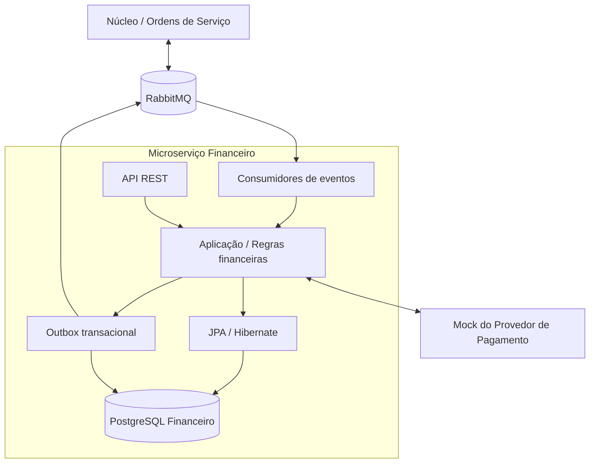
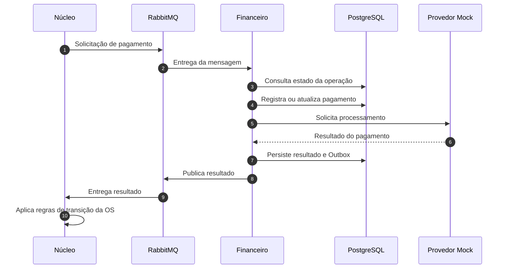
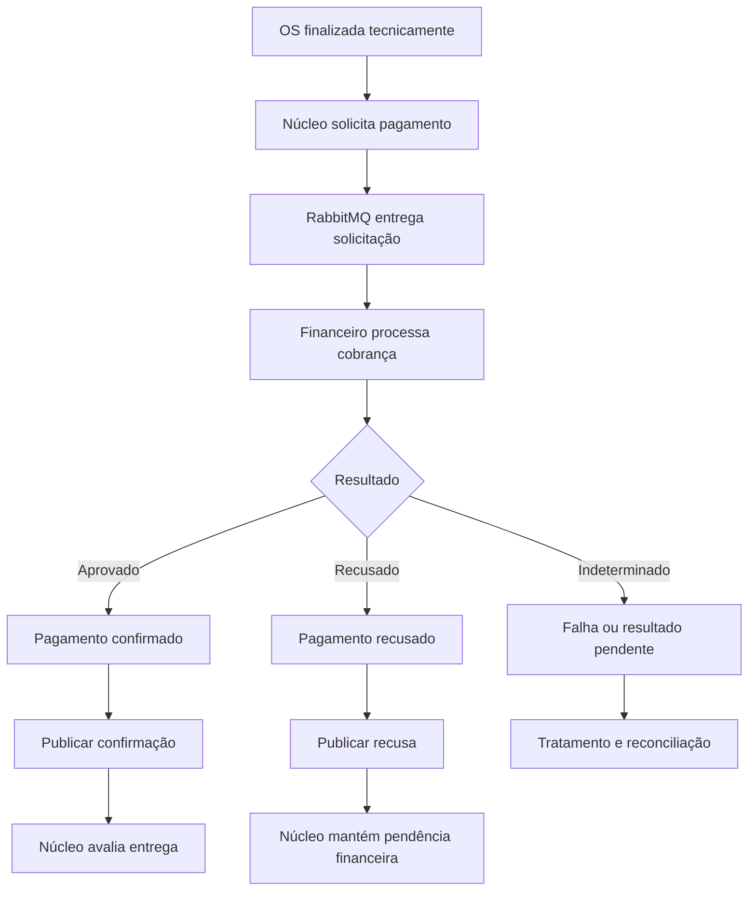

# Oficina Dinoco — Microserviço Financeiro

Microserviço responsável pelo gerenciamento de pagamentos das Ordens de Serviço (OS) da Oficina Mecânica Dinoco.

Desenvolvido como parte do **TechChallenge — Fase 4**, da pós-graduação em Arquitetura de Software da FIAP, com foco na evolução de uma aplicação monolítica para uma arquitetura de microserviços, comunicação assíncrona, consistência eventual e transações distribuídas utilizando o padrão Saga.

## 1. Visão geral

O Financeiro é um serviço independente responsável pelo processamento e acompanhamento dos pagamentos associados às ordens de serviço.

A aplicação possui persistência própria em PostgreSQL e se integra aos demais componentes da solução por meio de eventos assíncronos utilizando RabbitMQ.

Para permitir a execução e a validação dos fluxos sem depender de credenciais externas, a solução também disponibiliza uma aplicação independente que simula um provedor de pagamentos.

### Responsabilidades

- Gerenciar os registros financeiros vinculados às ordens de serviço.
- Processar solicitações de pagamento provenientes do fluxo distribuído.
- Integrar-se ao provedor de pagamentos.
- Persistir identificadores, valores, estados e resultados das operações.
- Disponibilizar informações financeiras por meio de API REST.
- Publicar eventos para comunicar os resultados ao núcleo.
- Participar da Saga distribuída, respeitando a responsabilidade de cada microserviço.
- Evitar processamento duplicado de operações por meio de mecanismos de idempotência.

O Financeiro **não é responsável por alterar diretamente o estado das ordens de serviço, controlar estoque ou executar procedimentos mecânicos**. Essas operações pertencem ao núcleo da aplicação.

---

## 2. Contexto do TechChallenge — Fase 4

A quarta fase do TechChallenge propõe a evolução da arquitetura da Oficina Dinoco por meio da decomposição do monolito e da adoção de padrões de integração distribuída.

O projeto contempla os seguintes aspectos:

| Requisito técnico | Abordagem |
|---|---|
| Arquitetura de microserviços | Separação das responsabilidades entre os serviços |
| Persistência independente | Banco de dados próprio para o Financeiro |
| Comunicação assíncrona | Integração por RabbitMQ |
| Transações distribuídas | Participação em Saga coreografada |
| Consistência eventual | Propagação dos estados por eventos |
| Resiliência | Tratamento de falhas, duplicidade e reprocessamento |
| Testabilidade | Testes unitários e de integração |
| Documentação das APIs | OpenAPI e Swagger UI |
| Containerização | Docker |
| Qualidade de software | Testes automatizados, cobertura e análise estática |

A arquitetura prioriza baixo acoplamento entre os serviços, autonomia de implantação e isolamento das responsabilidades de negócio.

---

## 3. Tecnologias

| Tecnologia | Utilização |
|---|---|
| Java 21 | Linguagem de programação |
| Spring Boot | Framework da aplicação |
| Spring Web | APIs REST |
| Spring Data JPA / Hibernate | Persistência das entidades financeiras |
| PostgreSQL | Banco de dados relacional |
| Flyway | Versionamento e evolução do banco |
| RabbitMQ | Mensageria assíncrona |
| Spring AMQP | Integração com RabbitMQ |
| JdbcTemplate | Operações transacionais da Outbox |
| OpenAPI / Swagger UI | Documentação das APIs |
| Maven | Build e dependências |
| JUnit 5 / Mockito | Testes automatizados |
| Docker / Docker Compose | Execução local |

## 4. Arquitetura da solução

O Financeiro possui responsabilidade exclusiva sobre seu domínio e seu banco de dados.

A comunicação com os demais microserviços deve ocorrer por contratos de integração, evitando dependência direta de tabelas e entidades de outros domínios.



### 4.1. Persistência

A persistência do Financeiro utiliza entidades JPA, repositórios Spring Data e gateways de infraestrutura.

Entre os componentes dessa implementação estão:

- `PagamentoEntity`: representação persistente do pagamento.
- `PagamentoJpaRepository`: interface de acesso aos registros financeiros.
- `PagamentoGatewayImpl`: implementação do contrato de persistência utilizado pela aplicação.

A separação permite manter as regras de negócio desacopladas dos detalhes de acesso ao PostgreSQL.

### 4.2. Outbox transacional

A Outbox é utilizada para reduzir o risco de inconsistência entre a gravação do estado financeiro e a publicação de eventos.

O registro financeiro e a mensagem de saída são persistidos na mesma transação do banco de dados.

A implementação utiliza `JdbcTemplate` para as operações da Outbox, enquanto a persistência das entidades financeiras utiliza JPA.

O funcionamento segue esta sequência:

1. A aplicação processa uma operação financeira.
2. O estado do pagamento é persistido.
3. O evento correspondente é registrado na Outbox, na mesma transação.
4. Após a confirmação da transação, o evento fica disponível para publicação.
5. O publicador encaminha a mensagem ao RabbitMQ.
6. O evento publicado pode ser consumido pelo serviço responsável pela próxima etapa.

Se ocorrer uma falha na transação, tanto a atualização financeira quanto o registro do evento são revertidos.

Esse mecanismo evita que um evento seja considerado pronto para publicação quando a alteração financeira correspondente não foi confirmada.

A Outbox, isoladamente, não garante entrega exatamente uma vez. Consumidores devem tratar possíveis mensagens duplicadas.

---

## 5. Fluxo de pagamento

O pagamento integra a etapa financeira do ciclo de vida de uma ordem de serviço.

A conclusão técnica da OS é responsabilidade do núcleo. O Financeiro participa posteriormente, quando uma operação de cobrança é necessária.

### 5.1. Processamento



### 5.2. Pagamento aprovado

Quando o provedor confirma o pagamento:

1. O Financeiro identifica a operação correspondente.
2. Registra o resultado no banco.
3. Prepara o evento de confirmação.
4. Publica o evento pelo mecanismo de mensageria.
5. O núcleo recebe a confirmação e avalia a continuidade do ciclo de vida da OS.

A confirmação financeira permite que o núcleo prossiga para a entrega, conforme suas regras de negócio.

### 5.3. Pagamento recusado

Quando o provedor recusa o pagamento:

1. O Financeiro registra a recusa.
2. O resultado é comunicado ao núcleo.
3. O núcleo mantém a OS em um estado compatível com a pendência financeira.
4. Um novo processamento poderá depender das regras de retentativa e cobrança.

**Uma recusa de pagamento não desfaz um reparo mecânico já executado.** A compensação deve respeitar a natureza da operação e a possibilidade real de reversão.

### 5.4. Falhas técnicas

Falhas de comunicação, indisponibilidade do provedor ou interrupções na mensageria não devem ser confundidas automaticamente com uma recusa de pagamento.

A aplicação deve distinguir resultados definitivos de situações em que o processamento permanece desconhecido ou pendente.

Essas situações exigem tratamento específico para evitar cobranças duplicadas e decisões financeiras incorretas.

---

## 6. Integração com RabbitMQ e Saga

A comunicação assíncrona permite que o Financeiro processe operações sem depender de chamadas HTTP síncronas entre todos os microserviços.

A solução utiliza a abordagem de **Saga coreografada**, na qual os serviços reagem a eventos e executam suas responsabilidades locais, sem um coordenador central controlando cada transação.

### 6.1. Participação do Financeiro



Os nomes apresentados nos diagramas descrevem eventos de negócio conceituais. Os nomes físicos das filas, exchanges, routing keys e tipos de mensagem são definidos pelas configurações e contratos de mensageria da aplicação.

### 6.2. Consistência eventual

Cada microserviço confirma suas transações localmente.

O estado global da Saga é construído progressivamente, conforme os eventos são entregues e processados.

Consequentemente, podem existir intervalos em que o pagamento já foi confirmado no Financeiro, mas o núcleo ainda não atualizou a situação da OS.

Isso é esperado em arquiteturas assíncronas e deve ser tratado pelos consumidores de eventos.

### 6.3. Idempotência

Uma mensagem pode ser entregue mais de uma vez pelo broker.

O processamento deve impedir que a repetição do mesmo comando ou evento produza efeitos financeiros duplicados.

A verificação de identificadores de operação, estados já processados e registros persistidos contribui para a proteção contra duplicidade.

### 6.4. Compensações

As compensações de uma Saga representam operações de negócio destinadas a desfazer ou neutralizar efeitos de etapas anteriores quando necessário.

No domínio financeiro, uma compensação pode envolver cancelamento, estorno ou outra operação suportada pelo provedor.

Não se deve simplesmente excluir um registro financeiro já confirmado para simular uma compensação.

As ações compensatórias precisam preservar a rastreabilidade das operações.

---

## 7. Provedor de pagamento simulado

O projeto inclui uma aplicação independente que simula um provedor externo de pagamentos.

O Mock permite validar o comportamento do Financeiro sem dependência de um gateway de pagamento real.

### Objetivos

- Simular o processamento de pagamentos.
- Permitir testes da integração HTTP.
- Validar o tratamento das respostas do provedor.
- Reproduzir cenários de aprovação e recusa conforme os contratos disponíveis.
- Facilitar a execução do ambiente local.

O Mock representa uma dependência externa e **não substitui o banco de dados ou as regras financeiras do microserviço**.

### Documentação da API do Mock

Após iniciar a aplicação:

http://localhost:8090/swagger-ui.html

A documentação interativa apresenta os endpoints, parâmetros e modelos disponibilizados pelo provedor simulado.

---

## 8. APIs REST e Swagger

O Financeiro disponibiliza endpoints REST para acesso às operações financeiras implementadas.

Os contratos HTTP são publicados por meio de OpenAPI e podem ser consultados no Swagger UI.

### Swagger — Financeiro

http://localhost:8082/swagger-ui/index.html

### Swagger — Provedor Mock

http://localhost:8090/swagger-ui.html

A documentação deve permitir identificar os modelos de entrada e saída, os códigos HTTP e as operações disponíveis.

O Swagger do Financeiro documenta exclusivamente a API financeira. As operações internas do provedor simulado possuem documentação separada.

---

## 9. Execução local

### 9.1. Pré-requisitos

- JDK 21
- Docker e Docker Compose
- Maven ou Maven Wrapper do projeto
- Portas locais disponíveis para as aplicações e dependências

### 9.2. Serviços envolvidos

| Componente | Finalidade | Acesso local |
|---|---|---|
| Financeiro | API e processamento financeiro | `localhost:8082` |
| Provedor Mock | Simulação de pagamentos | `localhost:8090` |
| PostgreSQL | Persistência financeira | Configurado no ambiente |
| RabbitMQ | Filas e exchanges | Configurado no ambiente |
| Núcleo | Gestão das ordens de serviço | `localhost:8080` |

Os serviços de infraestrutura devem utilizar as credenciais e portas definidas nos arquivos de configuração e no Docker Compose.

### 9.3. Inicializar a infraestrutura

A partir da raiz do projeto, iniciar os serviços disponíveis no arquivo Compose:

```bash
docker compose up -d
```

Para verificar a inicialização:

```bash
docker compose ps
```

Para acompanhar os logs:

```bash
docker compose logs -f
```

A composição e os nomes dos serviços são determinados pelo `docker-compose.yml` do repositório.

### 9.4. Executar o Financeiro

Com PostgreSQL, RabbitMQ e demais dependências necessárias disponíveis, a aplicação pode ser iniciada pela IDE, selecionando a classe principal do Spring Boot.

Também é possível utilizar o Maven Wrapper:

**Linux / macOS**

```bash
./mvnw spring-boot:run
```

**Windows**

```powershell
.\mvnw.cmd spring-boot:run
```

A execução depende das configurações de ambiente e dos perfis Spring habilitados.

### 9.5. Executar o provedor Mock

O provedor simulado deve ser iniciado como aplicação independente, utilizando seu módulo, artefato ou serviço Docker correspondente.

Após a inicialização, acessar:

http://localhost:8090/swagger-ui.html

### 9.6. Verificar a inicialização

Com as aplicações disponíveis:

1. Acessar o Swagger do Financeiro.
2. Acessar o Swagger do Mock.
3. Verificar a conectividade com PostgreSQL.
4. Verificar a conexão com RabbitMQ.
5. Confirmar que as migrations do Flyway foram aplicadas.
6. Executar uma operação financeira por meio do contrato REST ou do fluxo de integração.

A execução completa do fluxo distribuído requer que os serviços envolvidos estejam conectados ao mesmo ambiente de mensageria.

---

## 10. Testes

O projeto utiliza testes automatizados para validar as regras financeiras e as integrações.

### 10.1. Testes Java

Executar a suíte:

**Linux / macOS**

```bash
./mvnw clean test
```

**Windows**

```powershell
.\mvnw.cmd clean test
```

Para executar as verificações do ciclo Maven:

```bash
./mvnw clean verify
```

Os testes Java devem contemplar os comportamentos implementados de aplicação, domínio, persistência e integração.

### 10.2. Testes HTTP do provedor Mock

O Mock possui testes próprios de contratos e respostas HTTP.

Eles devem ser executados no contexto da aplicação do provedor, utilizando o mecanismo de testes configurado no respectivo módulo.

Esses testes verificam as respostas expostas pela API simulada, independentemente das regras internas do Financeiro.

### 10.3. Teste integrado de pagamento

Um teste de integração do fluxo completo deve verificar:

1. A emissão da solicitação de pagamento.
2. A entrega da mensagem pelo RabbitMQ.
3. O processamento no Financeiro.
4. A comunicação com o Mock.
5. A persistência do resultado.
6. O registro e a publicação do evento de saída.
7. O consumo do resultado pelo núcleo.
8. A atualização do estado da OS conforme a regra aplicável.

### 10.4. Cenários relevantes

| Cenário | Comportamento esperado |
|---|---|
| Pagamento aprovado | Resultado confirmado e evento correspondente |
| Pagamento recusado | Recusa registrada e comunicada |
| Mensagem duplicada | Ausência de efeito financeiro duplicado |
| Falha no provedor | Tratamento sem aprovação indevida |
| Falha de publicação | Evento preservado para recuperação pela Outbox |
| Mensagem ainda não consumida | Consistência eventual até conclusão do processamento |
| Solicitação repetida | Respeito às regras de idempotência e estado |

A execução de cada cenário depende dos mecanismos efetivamente disponibilizados pelos testes e contratos do projeto.

---

## 11. Configurações de ambiente

As configurações do Financeiro são centralizadas nos arquivos Spring e nas variáveis de ambiente utilizadas na implantação.

Entre os parâmetros necessários estão:

| Configuração | Descrição |
|---|---|
| Porta HTTP | Porta da API do Financeiro |
| Datasource | Conexão com PostgreSQL |
| Credenciais do banco | Usuário e senha do Financeiro |
| RabbitMQ | Host, porta e credenciais do broker |
| Filas e exchanges | Contratos físicos de mensageria |
| Provedor | Endereço HTTP do Mock ou provedor externo |
| Flyway | Configurações de migração |
| Outbox | Configurações de publicação e recuperação |

Credenciais sensíveis devem ser fornecidas por variáveis de ambiente ou mecanismo apropriado de gerenciamento de segredos.

As configurações locais não devem exigir acesso direto ao banco de outro microserviço.

---

## 12. Limites de responsabilidade

| Componente | Responsabilidade |
|---|---|
| Núcleo | Ciclo de vida das ordens de serviço e regras operacionais |
| Catálogo de Produtos | Cadastro e consulta de produtos |
| Catálogo de Serviços | Cadastro e consulta de serviços |
| Financeiro | Registro, processamento e acompanhamento dos pagamentos |
| Provedor Mock | Simulação de operações de pagamento |
| RabbitMQ | Transporte assíncrono de mensagens |

Essa separação garante que o Financeiro possa evoluir sem depender da estrutura interna de persistência do núcleo.

---

## 13. Considerações arquiteturais

O projeto adota alguns princípios importantes para sistemas distribuídos:

**Autonomia de dados:** cada serviço mantém a autoridade sobre seus próprios registros.

**Integração por eventos:** os serviços comunicam fatos e resultados sem compartilhamento direto de tabelas.

**Consistência eventual:** as atualizações entre microserviços não precisam ocorrer na mesma transação de banco de dados.

**Transações locais:** a Saga é composta por operações individuais confirmadas pelos serviços participantes.

**Resiliência:** falhas temporárias não devem comprometer a rastreabilidade financeira.

**Observabilidade:** mensagens e operações devem possuir identificadores que permitam correlacionar o processamento distribuído.

**Segurança:** credenciais de integração e dados financeiros devem ser protegidos de acordo com sua finalidade.

---

## 14. Documentação complementar

A documentação da arquitetura distribuída completa, incluindo a Saga de ponta a ponta, pertence ao projeto principal da Oficina Dinoco.

Este repositório concentra a documentação do domínio financeiro, seus contratos, sua persistência e suas integrações.

Para explorar os contratos disponíveis localmente, consultar:

- [Swagger do Financeiro](http://localhost:8082/swagger-ui/index.html)
- [Swagger do Provedor Mock](http://localhost:8090/swagger-ui.html)

---